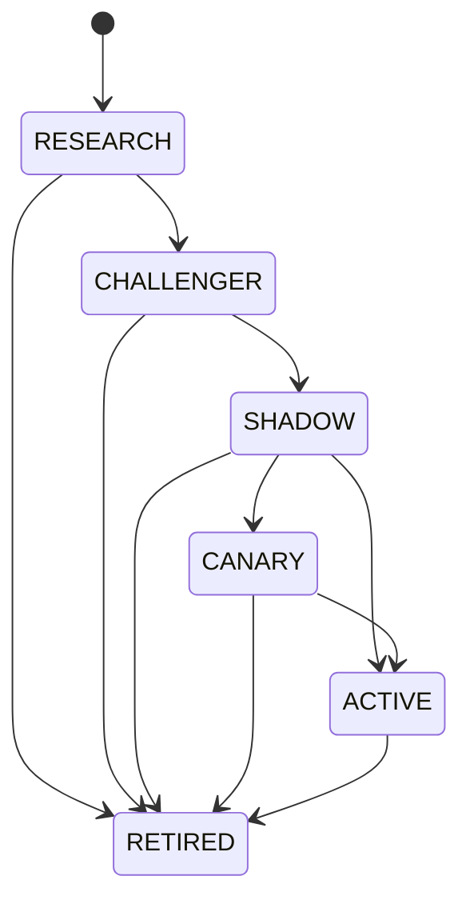
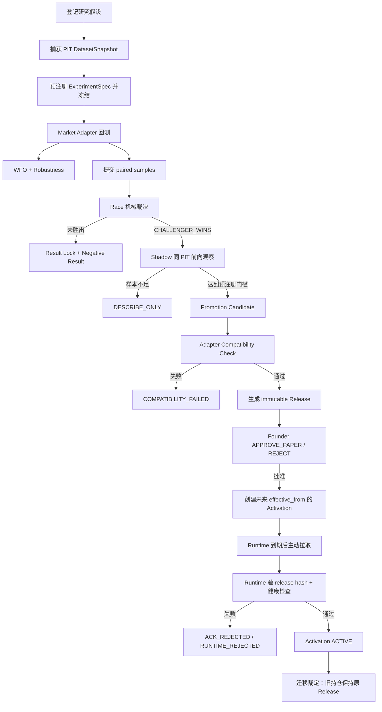
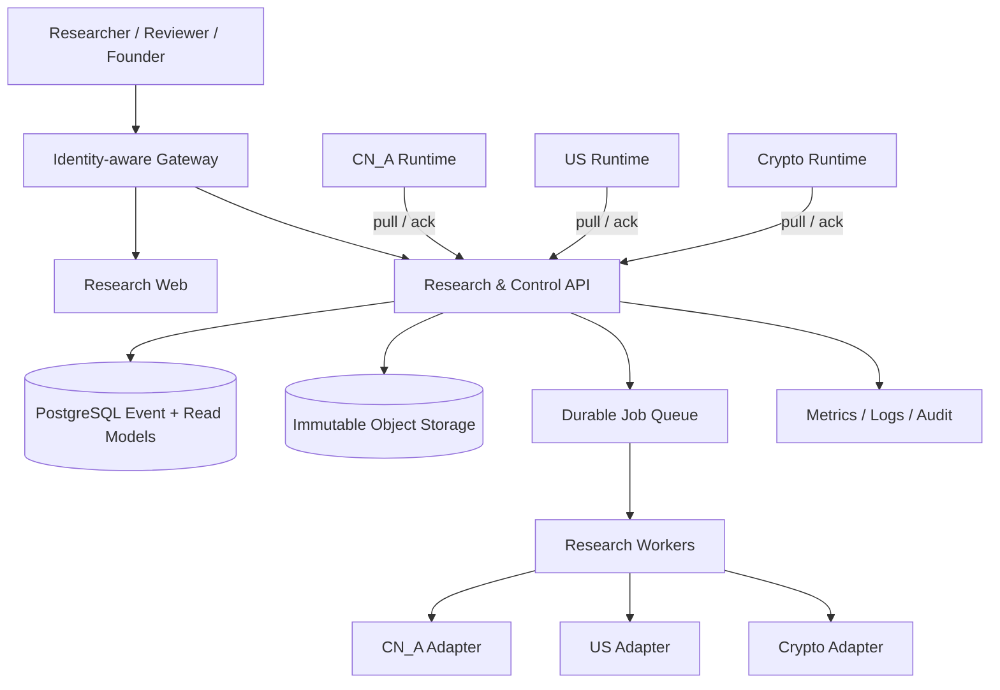

# Quant Research Platform 系统架构设计

| 项目 | 内容 |
|---|---|
| 文档版本 | 1.0 |
| 基线提交 | `02219467e30cb4374a0236140424e8977697d122` |
| 核验日期 | 2026-10-23 |
| 适用仓库 | `UpMeAI/quant-research-platform` |
| 文档性质 | 当前实现基线、目标架构和演进边界的统一说明 |

## 1. 文档目标与验收口径

本方案回答五个问题：

1. 平台负责什么，和各市场数据及执行系统如何分工；
2. 一项策略研究如何从假设走到可审计的 Paper 激活；
3. 数据、实验结果、策略版本和 Runtime 状态各由谁生产、谁拥有；
4. 当前代码已经实现到什么程度，哪些仍是目标设计；
5. 从当前 MVP 演进为可长期运行的多市场研究平台，需要补齐哪些能力。

本文的“已实现”只以本仓基线代码、测试和可运行命令为依据。仓库外服务是否在线、是否接通生产数据、是否完成商业部署，不因 README 中存在目标描述而被视为已验证。

本次核验未在仓库中找到 README 所称的《多市场量化策略研究与策略控制平台产品设计》（2026-08-22）原始文件。因此，本文件不会把该外部设计稿当作可寻址的冻结合同。当前事实的优先级为：可执行合同与状态机代码 → Schema → 自动化测试 → 当前仓库文档；未来若补入原始产品合同，应给出版本、地址和与本方案的差异清单。

文档完成的确定性验收标准是：

- 覆盖产品边界、逻辑分层、主数据流、权威生产者、领域模型、接口、存储、安全、部署、观测、故障语义、验证和路线图；
- 明确区分“当前实现”“已预留接口”“目标状态”；
- 所有当前能力都能定位到代码文件或测试；
- 不把合成数据、回测、Shadow、Paper 或计划中的市场能力表述为真实交易；
- 不在前端、报告或本文中建立第二套业务判定逻辑。

## 2. 产品定位

Quant Research Platform 是一个**多市场策略研究与策略控制平台**。它把研究治理做成共享能力，让不同市场在保留自身数据、交易日历、成本模型和执行系统的前提下，使用一致的研究与发布协议。

平台的核心产物不是订单，而是四类受治理资产：

- 可追溯的研究资产：假设、数据快照、实验、回测、WFO、稳健性报告和负结果；
- 可比较的策略资产：策略族、模块版本、Bundle、Race 和统一指标；
- 可前向观察的证据：Shadow Run、逐事件分歧和虚拟账本；
- 可发布的控制资产：Promotion Candidate、不可变 Release、Activation、ACK/NACK、回滚和迁移裁定。

平台当前的永久安全边界是：

- `real_order = 0`；
- 不持有券商或交易所凭证；
- 不拥有实时订单、成交、账户和持仓真相；
- 不自动晋升策略；
- MVP 只允许 `PAPER`，`CANARY` 和 `LIVE` 仅存在于通用枚举中；
- 策略发布采用 Runtime 主动拉取，不由平台向 Runtime 推送；
- 已有持仓不随新版本静默迁移。

## 3. 当前状态结论

| 能力 | 当前状态 | 证据或限制 |
|---|---|---|
| A 股本地研究闭环 | 已实现，可确定性演示 | `adapters/ashare-local`、`npm run mvp:ashare`；默认数据为 `SAMPLE_SYNTHETIC` |
| 研究治理 | 已实现 | 预注册、冻结、单结果锁、Race、Shadow、Promotion、Release、Activation |
| 研究台 | 已实现本地零依赖版本 | 六个只读页面；Founder 审批和激活使用静态令牌 |
| Runtime 拉取协议 | 已实现协议与本地 stub | HTTP 拉取、hash 校验、健康检查、ACK/NACK；stub 不产生真实订单 |
| 生产 A 股适配器 | 本仓仅有合同与文档引用 | 本仓启动时默认仍注册本地演示适配器，未验证仓外服务在线 |
| 美股、加密适配器 | 只有注册入口与客户端 | `remote_markets.js` 已定义配置，但 API 启动流程没有调用注册函数 |
| 生产存储 | 未实现 | 当前为本地 append-only JSONL，无数据库、对象存储、并发写锁或备份流程 |
| 作业编排 | 未实现为常驻调度系统 | CLI 串行演示；无队列、调度器、worker 或运行租约 |
| 用户、组织、RBAC | 未实现 | 只有两个全局共享令牌，不是用户级身份系统 |
| 实盘交易 | 明确不在范围 | 无 Broker 接口，无真实下单权限 |

因此，当前最准确的定义是：**具备严格研究治理语义和完整 A 股合成数据演示闭环的单进程 MVP，并为跨仓多市场适配和 Runtime 拉取预留了合同。**

## 4. 总体架构

```mermaid
flowchart LR
  subgraph MarketRepos[各市场仓库与数据域]
    CN[CN_A Adapter\nAshare Runtime]
    US[US_EQUITY Adapter\nUS Runtime]
    CR[CRYPTO Adapter\nCrypto Runtime]
  end

  subgraph QRP[Quant Research Platform]
    API[Research API / Web]
    REG[Strategy Registry]
    EXP[Experiment Orchestrator]
    LAB[Factor Lab]
    RACE[Race Orchestrator]
    SHD[Shadow Control]
    CP[Strategy Control Plane]
    OBS[Runtime Status / Observability]
    LEDGER[(Append-only Ledgers)]
  end

  CN -->|MarketAdapter Contract| EXP
  US -. planned .->|HTTP_JSON_RPC_V1| EXP
  CR -. planned .->|HTTP_JSON_RPC_V1| EXP
  REG --> EXP --> RACE --> SHD --> CP
  LAB -->|research evidence only| EXP
  REG --> LEDGER
  EXP --> LEDGER
  RACE --> LEDGER
  SHD --> LEDGER
  CP --> LEDGER
  API --> REG
  API --> EXP
  API --> RACE
  API --> SHD
  API --> CP
  API --> OBS
  CN -->|pull Activation / ACK / NACK| CP
  US -. planned .->|pull| CP
  CR -. planned .->|pull| CP
  CN -->|read-only runtime truth| OBS
  US -. planned .-> OBS
  CR -. planned .-> OBS
```

架构采用“两平面、一边界”的分工：

- **Research Plane**：策略资产、研究协议、实验、回测、Race、Shadow；
- **Strategy Control Plane**：候选、兼容性、Release、人工审批、Activation、回滚、迁移裁定；
- **Market Runtime Boundary**：市场数据与执行真相留在市场仓库，平台只通过合同读取研究能力和运行状态。

## 5. 逻辑分层与代码落点

| 层 | 职责 | 当前实现 |
|---|---|---|
| L0 治理与身份 | ID、哈希、状态机、append-only 语义 | `packages/domain-model`、`packages/ledger`、`packages/result-lock` |
| L1 策略资产 | Family、ModuleVersion、BundleManifest | `services/strategy-registry` |
| L2 研究定义 | Hypothesis、ExperimentSpec、FactorDefinition | `services/experiment-orchestrator`、`services/factor-lab` |
| L3 数据与验证 | DatasetSnapshot、Backtest、WFO、Robustness | Experiment Orchestrator + Market Adapter |
| L4 相对赛马 | paired sample、guardrail、canonical metrics、regime breakdown | `services/race-orchestrator` |
| L5 前向观察 | Shadow、disagreement、Virtual Ledger | `services/shadow-control` |
| L6 策略控制 | Candidate、Compatibility、Release、Activation、Rollback、Migration | `services/strategy-control-plane` |
| L7 市场适配 | 统一合同、注册表、HTTP 客户端 | `packages/contracts`、`adapters/registry`、`adapters/clients` |
| L8 市场 Runtime | 行情、订单、成交、持仓、账户、Broker | 仓外系统；本仓只有无交易能力的 Paper stub |
| 产品与运维 | 六入口研究台、API、状态与观测 | `apps/research-*`、`services/runtime-status`、`services/observability` |

依赖方向必须保持从上层编排指向稳定合同，市场实现不能反向渗入平台核心：

```text
Web / API
  ↓
Application Services
  ↓
Domain + Contracts
  ↓
Ledger / Adapter Registry
  ↓
Market Adapter ── remote call ── Market Repository / Runtime
```

## 6. 权威生产者与消费关系

每个关键事实只能有一个权威生产者。其他模块只做投影、验证或消费。

| 事实 | 权威生产者 | 权威存储 | 主要消费者 |
|---|---|---|---|
| 原始行情与公司行为 | 各市场数据系统 | 市场仓库自有存储 | Market Adapter |
| PIT 数据快照 | Market Adapter | `dataset_snapshots.jsonl` | 实验、回测、审计 |
| 策略模块与 Bundle | Strategy Registry | registry ledgers | 实验、控制面、UI |
| 实验冻结定义 | Experiment Orchestrator | `experiments.jsonl` 首行 | 回测、Race、Result Lock |
| 回测产物 | Market Adapter；平台负责入账 | `backtest_artifacts.jsonl` | WFO、Robustness、Race |
| Race 结论 | Race Orchestrator 的机械裁决器 | `races.jsonl` | Result Lock、Promotion |
| 前向观察 | Market Adapter + Shadow Control | shadow ledgers | Promotion、观测 |
| Release 内容 | Strategy Control Plane | `strategy_releases.jsonl` | Runtime、回滚、审计 |
| 是否批准发布 | Founder 决策 | `promotion_candidates.jsonl` | Activation |
| 是否真正生效 | Market Runtime ACK + Control Plane | activation + ACK ledgers | Registry、Runtime Status |
| 当前持仓、成交、NAV | 各市场 Runtime | Runtime 自有账本 | 只读状态与经济健康 |
| 页面显示 | API 投影 | 不另存业务真相 | Research Web |

特别约束：

- 页面不得重算 Race、Shadow 是否足量、Release 是否有效或 Runtime 是否健康；
- Shadow 虚拟账本不得代替 Paper/Live 绩效；
- 未知持仓必须保持 `UNAVAILABLE`，不能写成 0 持仓；
- 未实现指标应保留 `NOT_IMPLEMENTED_MVP`、`NOT_IMPLEMENTED_P4` 或 `UNSUPPORTED`，不能用 0 或空对象代替。

## 7. 领域模型

### 7.1 策略资产

- `StrategyFamily`：描述经济机制、策略目标和市场范围；
- `StrategyModuleVersion`：不可变模块版本，类型为 `UNIVERSE / REGIME / THEME / SELECTION / TIMING / RISK / EXIT`；
- `StrategyBundleManifest`：同一市场内的一组模块引用，是研究、发布和激活的最小策略单元；
- `StrategyRelease`：Bundle、代码、参数、适配器、Universe、信号、风险、执行和成本合同的不可变发布封装。

Bundle 状态机：



进入 `ACTIVE` 必须携带 `activationRef`。唯一例外是 Champion 导入，它只记录 Runtime 既有状态，不代表平台完成了一次新发布。

### 7.2 研究资产

- `ResearchHypothesis`：问题、机制、预期改善、主指标、次指标、guardrails、失败条件；
- `DatasetSnapshot`：`as_of`、known-at 规则、来源、checksum、覆盖、新鲜度和 lineage hash；
- `ExperimentSpec`：运行前冻结的研究协议；
- `BacktestArtifact`：市场原生回测结果及 `result_hash`；
- `WFOReport`、`RobustnessReport`：滚动样本外和五类扰动证据；
- `NegativeResult`：守擂、失败和被证伪假设的长期资产。

冻结字段包括市场、双方版本、唯一变量、固定变量、数据快照、Universe、Regime、持有期、样本、成本、执行、信号动作、回撤口径、指标、守卫、失败条件、多重检验策略、参数网格、随机种子和前向最低证据。冻结后需要改变任何一项，都必须作废当前实验并创建新实验。

### 7.3 发布与运行资产

- `PromotionCandidate`：同时引用 Research Gate 和 Shadow Gate；
- `ActivationRecord`：Founder 已批准、等待目标 Runtime 拉取的生效请求；
- `RuntimeAck/Nack`：Runtime 的 hash、健康检查和接受/拒绝证据；
- `RollbackRecord`：运行故障或经济复核后的恢复动作；
- `MigrationAssessment / ReplanRequired`：新 Release 对已有持仓的显式裁定。

## 8. 研究到生效的完整链路



主要门槛：

1. **研究协议完整**：Universe、信号动作、回撤、成本等字段不能省略；
2. **冻结完整**：运行前后 `freeze_hash` 必须一致；
3. **单结果锁**：每个实验只能登记一次结论；
4. **受控比较**：双方必须同市场、Universe、PIT、交易日、成本和基准；
5. **机械裁决**：Challenger 主指标更优且无 guardrail 违约才算胜出；
6. **前向证据**：Shadow 达到预注册的总体和分 Regime 样本门槛；
7. **兼容性**：目标市场适配器验证 Release；
8. **人工批准**：只有 Founder 能批准 Paper 发布；
9. **未来生效**：Promotion Activation 的 `effective_from` 必须晚于申请日；
10. **Runtime 自证**：Runtime 验 hash、报告健康且保持 `real_order=0`、`broker_connection=false`；
11. **迁移显式化**：已有持仓只生成 `REPLAN_REQUIRED`，不自动修改计划。

## 9. 数据架构与 PIT 纪律

### 9.1 数据入口

共享平台不直接连接市场数据库。每个 Market Adapter 负责：

- 从本市场权威数据层读取行情和必要的公司行为或资金费率；
- 按真实可知时间生成 PIT 快照；
- 执行市场原生回测和 Shadow；
- 把结果归一为平台合同。

当前 A 股本地适配器使用 JSONL 日线：

```json
{
  "instrument_id": "600000.SH",
  "d": "2026-01-05",
  "close": 10.0,
  "high": 10.2,
  "vol": 1000000,
  "source": "SAMPLE_SYNTHETIC"
}
```

该实现按 `(instrument_id, d)` 取最后一行作为当前值，适合本地确定性演示，但还不是生产级点时数据库。生产设计需要保留：

- `observation_time`：市场事实所属时间；
- `first_available_at`：研究者首次可见时间；
- `retrieved_at`：平台取得时间；
- `revision` 与 `supersedes`：修订关系；
- `source_owner / source_url / license_ref`；
- 原始对象 hash、标准化投影 hash、采集批次和解析器版本；
- corporate action、退市、历史成分和交易日历的版本引用。

### 9.2 快照与可重放性

`DatasetSnapshot` 是实验数据的唯一入口。它至少绑定：

- 市场和 `as_of`；
- known-at policy；
- source refs 与 checksum；
- Universe 覆盖和数据新鲜度；
- 公司行为或资金费率引用；
- lineage hash。

后续回测、WFO、稳健性测试和 Race 都必须引用同一快照。修改数据快照等同于修改实验输入，必须创建新实验。

### 9.3 数据质量状态

生产版必须分别保留以下状态：

| 状态 | 含义 | 是否允许进入发布证据 |
|---|---|---|
| `OK` | 合同、覆盖、时点和来源均通过 | 允许 |
| `STALE` | 数据存在但超过预设新鲜度 | 由预注册协议决定；默认不自动放行 |
| `MISSING` | 预期记录不存在 | 不允许用 0 补齐 |
| `CONFLICT` | 权威来源间无法协调 | 不允许静默选择 |
| `UNKNOWN` | 无法确认状态 | 只描述，不晋升 |
| `NOT_APPLICABLE` | 该市场或资产不适用 | 不计为已覆盖，也不算失败 |

当前代码只在局部实现上述语义，尚未形成统一 `DataQualityEnvelope` 合同，这是生产化的首要补项。

## 10. Market Adapter 架构

### 10.1 必需合同

每个市场适配器必须提供：

| 函数 | 作用 |
|---|---|
| `snapshot(request)` | 生成 PIT `DatasetSnapshot` |
| `run_backtest(experimentSpec, opts)` | 执行市场原生回测 |
| `run_shadow(shadowSpec, evalDate)` | 产生同 PIT 前向观察 |
| `validate_release(strategyRelease)` | 校验市场、数据、成本和执行兼容性 |
| `runtime_capabilities()` | 声明 Runtime 身份和安全能力 |
| `normalize_result(nativeResult)` | 输出统一八轴 `CanonicalRaceMetrics` |

可选能力包括 Regime 标签和 Runtime 只读事实。缺少可选能力时必须返回或投影为 `UNSUPPORTED`，不能构造代理事实冒充已接入。

### 10.2 远程传输

远程适配器使用 `HTTP_JSON_RPC_V1`：

- `POST {baseUrl}/manifest` 取得 manifest；
- `POST {baseUrl}/{fn}`；
- 请求体为 `{ "args": [...] }`；
- 成功体为 `{ "result": ... }`；
- 使用 `X-Adapter-Token`；
- 默认超时 120 秒；
- manifest 自报 `market_id` 必须与配置槽位一致，否则拒绝注册。

当前配置槽位：`CN_A`、`US_EQUITY`、`CRYPTO`。代码已能创建远程客户端，但当前 `research-api` 启动路径不会调用 `registerConfiguredRemoteMarkets()`。生产启动器必须在开放服务前完成注册并在任一已配置市场连接或合同失败时 fail closed。

### 10.3 统一指标

Race 只读取 `CanonicalRaceMetrics` 的八个轴：

1. absolute；
2. risk；
3. relative；
4. trading_quality；
5. robustness；
6. operational；
7. capacity；
8. cost_breakdown。

成本必须按市场逐项说明。A 股佣金与印花税、美国做空借券费、加密永续 funding 和跨币种 FX 不能被一个通用成本率抹平。

## 11. 研究计算架构

### 11.1 回测

平台负责验证冻结状态、选择适配器、调用和入账；实际市场算法属于适配器。当前本地 A 股引擎是信号层等权模拟：收盘信号入场，固定交易日后收盘退出，双边成本均摊，不代表完整组合和真实成交。

### 11.2 WFO

WFO 使用实验预注册的 `train_days / test_days / step_days / folds` 和 `parameter_grid`：

- 只在训练段选参；
- 只用测试段比较 Champion 与 Challenger；
- fold 日期和可评测区间求交；
- 单网格异常作为异常记录，不能静默写成 0；
- 报告胜出比例和参数稳定性，不自行发明通过阈值。

### 11.3 稳健性

当前覆盖五个维度：参数扰动、子样本、时间分段、执行压力和数据源。某个维度不适用时保留 `NOT_APPLICABLE`。报告只提供机械事实，最终阈值来自实验预注册。

### 11.4 Race

Race 保存原始 paired samples，并按冻结主指标和 guardrails 裁决：

```text
指标缺失                       → INCONCLUSIVE
任一 guardrail 违约            → NEGATIVE_RESULT
Challenger 主指标 > Champion   → CHALLENGER_WINS
否则                           → CHAMPION_HOLDS
```

Regime breakdown 只能消费适配器提供的标签；没有标签时为 `UNSUPPORTED`。

### 11.5 Factor Lab

Factor Lab 只回答统计信息问题，输出 IC、Rank IC、衰减、覆盖和稳定性。`production_action_authority = NONE`，因子要影响生产必须进入 Strategy → Bundle → Race → Shadow → Promotion 全链。

当前合同层把 `evaluate_factor` 当作适配器可选实现来使用，但 `OPTIONAL_ADAPTER_FNS` 没有列出它，远程客户端也不会挂载该函数。这是一个实际合同不一致，需要在后续版本中统一。

## 12. Shadow 架构

Shadow 的职责是收集新旧策略在真实前向时点上的差异，不改变 Runtime：

- Champion 和 Challenger 消费相同 PIT 输入、bar cutoff 和成本模型；
- 同 `(shadow_id, key)` 幂等；
- 每条观察保存输入引用、版本、数据质量、原因码和 outcome；
- 虚拟收益单独进入 Virtual Ledger；
- 总体及分 Regime 最低样本来自冻结实验；
- 样本不足或 Regime 无法核验时保持 `DESCRIBE_ONLY`；
- 运行故障和经济证伪分别归因。

Shadow 允许证明“前向观察达到了预注册样本门槛”，不证明真实成交或可实盘盈利。

## 13. 策略控制与生效协议

### 13.1 Release

Release 将 Bundle、代码、参数、适配器版本、Universe、信号、风险、执行和成本合同冻结为内容哈希。读取时重新计算 `release_hash`，避免 append-only 文件被追加篡改内容后仍被信任。

当前 `hash()` 使用 SHA-256 的前 16 个十六进制字符，适合 MVP 身份和测试；生产不可变制品、跨系统签名和长期防碰撞应保存完整 SHA-256，并保留旧短 hash 作为兼容字段。

### 13.2 Activation

Activation 只表示“已批准、等待 Runtime 加载”，不等于生效：

1. Founder 审批 Candidate；
2. 平台创建 `PENDING_RUNTIME_PULL`；
3. 未到 `effective_from` 时只出现在 scheduled 队列；
4. 到期后 Runtime 拉取 Activation 和 Release；
5. Runtime 本地重算 hash 并执行健康检查；
6. Runtime 回 ACK 或 NACK；
7. ACK 通过后 Activation 和 Bundle 才进入 `ACTIVE`；
8. 同一 Runtime 的前一个 ACTIVE Activation 标为 `SUPERSEDED`。

### 13.3 回滚

- `OPERATIONAL`：可生成指向 last-known-good Release 的恢复 Activation；
- `ECONOMIC`：先生成 Research Review Trigger，Founder 明确批准后才能执行；
- 恢复同样经过 Runtime 拉取、hash 和健康检查；
- 没有前任 Release 时明确记录 `NO_PREVIOUS_RELEASE_TO_RESTORE`。

### 13.4 迁移

新 Release 只影响之后的新 TradePlan。已持仓位继续绑定其 `originating_release_ref`。平台拿不到持仓时写 `UNAVAILABLE`；拿到后为受影响仓位逐条写 `REPLAN_REQUIRED`，最终处置仍由研究者或 Founder 决定。

## 14. API 与研究台

### 14.1 当前接口

只读接口：

| 方法与路径 | 内容 |
|---|---|
| `GET /api/strategies` | 市场、Family、Module、Bundle |
| `GET /api/experiments` | 假设、实验、回测摘要、WFO、稳健性、负结果、因子 |
| `GET /api/races` | Race、paired sample 数量、结果和统一指标 |
| `GET /api/shadow` | Shadow、样本充分度、虚拟指标和近期观察 |
| `GET /api/promotion` | Candidate、Release、Activation、Rollback、Migration |
| `GET /api/runtime-status` | Runtime 只读状态和运行/经济健康 |

Founder 写接口：

| 方法与路径 | 权限 | 作用 |
|---|---|---|
| `POST /api/review` | `X-Founder-Token` | `APPROVE_PAPER` 或 `REJECT` |
| `POST /api/activate` | `X-Founder-Token` | 创建未来生效的 Paper Activation |

Runtime 接口：

| 方法与路径 | 权限 | 作用 |
|---|---|---|
| `GET /api/runtime/pending-activations` | `X-Runtime-Token` | 拉取已到生效日的请求 |
| `GET /api/runtime/scheduled-activations` | `X-Runtime-Token` | 查看尚未到生效日的请求 |
| `GET /api/runtime/release` | `X-Runtime-Token` | 读取 Release 并自验 hash |
| `POST /api/runtime/ack` | `X-Runtime-Token` | 回报 hash 和健康检查 |
| `POST /api/runtime/nack` | `X-Runtime-Token` | 显式拒绝加载 |

### 14.2 当前产品界面

`apps/research-web/index.html` 是一个零依赖单页研究台，包含策略、实验、赛马、影子、发布和运行状态六个入口。它是研发与审计工具，不是多租户商业产品。

生产版 UI 应继续只消费 API 投影，并补齐：

- 用户、组织、角色和最小权限；
- 审批理由、二次确认和强身份认证；
- 大对象分页、筛选和服务端游标；
- 明确区分合成、回测、Shadow、Paper、Live；
- 研究证据与最终人工决策并列展示；
- 不在浏览器长期保存 Founder 或 Runtime 凭证。

## 15. 存储设计

### 15.1 当前实现

当前所有领域台账均为 `QRP_DATA_DIR` 下的 append-only JSONL：

```text
registry/
  strategy_families.jsonl
  strategy_modules.jsonl
  strategy_bundles.jsonl
research/
  hypotheses.jsonl
  dataset_snapshots.jsonl
  experiments.jsonl
  backtest_artifacts.jsonl
  wfo_reports.jsonl
  robustness_reports.jsonl
  races.jsonl
  paired_samples.jsonl
  factor_definitions.jsonl
  factor_evaluations.jsonl
  negative_results.jsonl
shadow/
  shadow_runs.jsonl
  shadow_observations.jsonl
  virtual_ledger.jsonl
control-plane/
  promotion_candidates.jsonl
  strategy_releases.jsonl
  activation_records.jsonl
  runtime_acks.jsonl
  migration_assessments.jsonl
marketdata/{market}/
  bars.jsonl
```

每次状态变化追加完整新行，读取时同 ID 取最后一行作为 head。写入前校验已登记 schema；无 schema 的记录只允许作为适配器自有原始数据。

### 15.2 生产目标

JSONL 不适合并发写、多实例、精确事务、索引查询或灾备。生产建议保持事件语义，替换物理实现：

| 数据类型 | 建议存储 | 关键要求 |
|---|---|---|
| 领域事件与状态 head | PostgreSQL | 事务、唯一键、乐观锁、审计序号 |
| 快照、回测、paired samples、大报告 | 对象存储 | content-addressed、写一次、校验和、生命周期 |
| 查询投影 | PostgreSQL materialized view 或独立 read model | 可重建，不作为判定真相 |
| 作业与租约 | 持久队列/数据库 | 幂等 key、重试分类、lease、dead letter |
| 密钥 | 云 Secret Manager | 版本化、轮换、审计，不进入业务库 |

迁移时必须保存现有 JSONL 作为历史证据，不重写旧事件。导入程序按 schema 验证并生成对账清单。

## 16. 安全与权限

### 16.1 已实现控制

- Founder 与 Runtime 令牌分离；
- 未配置令牌时写接口 fail closed；
- Runtime 令牌不能审批，Founder 令牌不能代替 Runtime ACK；
- Adapter token 与 Broker credential 分离；
- Release hash、Runtime hash、健康检查三重校验；
- Runtime 上报 `real_order != 0` 或 `broker_connection != false` 时拒绝激活；
- MVP 环境只允许 `PAPER`。

### 16.2 生产缺口

当前服务仍缺：TLS 终止设计、用户身份、RBAC、每 Runtime 独立凭证、令牌轮换、速率限制、请求审计、CSRF/Origin 策略、秘密管理、网络隔离和供应链签名。

生产权限模型建议：

- `RESEARCHER`：建假设、实验、查看结果；
- `REVIEWER`：审阅研究证据，无发布权；
- `FOUNDER_APPROVER`：批准或否决 Paper Release；
- `RUNTIME_AGENT`：只能访问自身 Runtime 的拉取与回执；
- `OPERATOR`：处理运行故障和 Operational rollback；
- `AUDITOR`：只读全部不可变证据。

进入 CANARY 或 LIVE 需要新的冻结合同、独立审批和真实券商安全审计，不能通过扩展现有 `MVP_ALLOWED_ENVIRONMENTS` 直接放开。

## 17. 可观测性与自审计

### 17.1 当前观测

`operationalHealth` 当前检查：

- 最近 DatasetSnapshot 的日期和年龄；
- Adapter 是否可达；
- 平台记录与 Runtime 自报的 Release ID/hash 是否漂移；
- 被拒和待拉取 Activation；
- Shadow 最近观察、样本缺口和数据质量；
- 未完成迁移裁定；
- Result Lock 和入账校验是否启用。

`economicHealth` 只读取 Runtime 绩效真相。Runtime 不提供时明确 `UNAVAILABLE`，并把 Shadow 虚拟账本单列。

### 17.2 生产自审计表

生产化应增加四张元表，它们只记录系统质量，不重算策略结论：

| 元表 | 目的 | 典型字段 |
|---|---|---|
| `strategy_baseline` | 冻结每个已批准版本的预期基线 | release、样本、指标定义、阈值、批准人 |
| `divergence_log` | 记录研究、Shadow、Paper/Runtime 之间的差异 | source run、target run、field、delta、原因、状态 |
| `incident_catalog` | 形成可复用故障目录 | 影响范围、根因、检测、恢复、复发保护 |
| `anomaly_watchlist` | 跟踪尚未定性的异常 | signal、first_seen、证据、owner、下一检查点 |

需要明确：这四张表在当前仓库中**尚未实现**。它们不能仅因本文提出就被视为已投产。

核心 SLI 建议包括：快照新鲜度、适配器成功率、作业排队时间、结果重放一致率、冻结校验失败数、Release hash 漂移数、ACK 延迟、Shadow 数据质量错误数、迁移未决数和审计写入成功率。

## 18. 故障与降级语义

| 故障 | 当前/目标行为 | 禁止行为 |
|---|---|---|
| Adapter 未注册 | `MARKET_ADAPTER_NOT_REGISTERED` | 返回空市场并继续裁决 |
| 已配置远程 Adapter 不可达 | 启动或调用失败 | 静默回退到别的市场或演示数据 |
| Snapshot 不完整 | 实验不能创建或标记不可判 | 用最新值回填历史 |
| 冻结 hash 漂移 | 拒绝回测/Race | 修改首行或重算后覆盖 |
| 指标缺失 | `INCONCLUSIVE` 或 guardrail 违约 | 当作 0 或忽略守卫 |
| Shadow 样本不足 | `DESCRIBE_ONLY` | 宣称可晋升 |
| Compatibility 失败 | `COMPATIBILITY_FAILED` | 仍生成 Release |
| Release hash 不一致 | `ACK_REJECTED` | 激活后补记错误 |
| Runtime 健康失败 | `ACK_REJECTED` | 自动重试至生效 |
| 持仓读取失败 | Migration `UNAVAILABLE` | 记为无持仓 |
| 经济表现变差 | 触发研究复核 | 按短期 PnL 自动回滚 |
| JSONL 并发冲突 | 当前没有可靠保护 | 在多实例生产环境直接共享目录 |

## 19. 部署拓扑

### 19.1 当前可运行拓扑

```text
单机 Node.js 进程
├─ Research API :4310
├─ 静态 Research Web
├─ 内置 CN_A Adapter
├─ 本地 Paper Runtime Stub
└─ 本地 JSONL 数据目录
```

运行命令：

```bash
npm test
node schemas/validate.js
npm run seed:ashare
npm run mvp:ashare
npm run web
```

仓库没有容器、IaC、CI workflow、生产进程管理器或部署清单，因此不能宣称存在可重复的生产部署。

### 19.2 目标部署拓扑



建议将同步 API 与长任务 worker 分离。回测、WFO、稳健性、批量 Shadow 重放不能占用 HTTP 请求生命周期。所有作业必须带：冻结输入 hash、幂等 key、attempt、lease、开始与结束时间、结构化错误和产物引用。

## 20. 性能与扩展

当前多个读接口会扫描完整 JSONL，`/api/experiments` 还会为每个实验重复读取产物和报告。数据量增大后复杂度和 I/O 会快速上升。

扩展顺序应为：

1. 先保持业务合同不变，把大产物迁入对象存储；
2. 为事件 head 建索引化 read model；
3. 把长任务迁入持久队列；
4. 用市场和实验做隔离分区；
5. 为页面增加分页与字段裁剪；
6. 最后再考虑并发研究 worker 和缓存。

缓存只能缓存可重建投影，不能缓存或覆盖审批、Activation、ACK、迁移和 Result Lock 的权威写入。

## 21. 备份、恢复与不可变性

生产恢复目标必须覆盖：

- 事件数据库的时间点恢复；
- 对象存储版本和写一次策略；
- Release、快照和产物 hash 对账；
- 从事件重建所有 read model；
- Runtime 当前生效 Release 与控制面 head 的双向核对；
- 恢复后禁止重放 Founder 审批或重复激活；
- 任何修正都追加新事件，不改历史事件。

当前本地 JSONL 没有仓库内定义的备份、恢复或并发一致性方案，`var/` 还被 gitignore。它只能作为开发数据目录。

## 22. 测试与发布证据

现有自动化覆盖：

- 领域状态机与 ID；
- 回测决定论；
- 实验冻结和 Result Lock；
- Race 守卫和 paired sample；
- WFO、稳健性和 Regime；
- Shadow 幂等、门槛和故障分类；
- Promotion、Activation、Rollback 和 No Silent Migration；
- Schema 与写入合同；
- A 股本地逻辑与源仓的反分叉守卫；
- 远程适配器注册和真实 HTTP 客户端；
- Runtime pull、hash、健康检查和 ACK/NACK；
- Founder/Runtime 令牌权限隔离。

当前确定性发布检查应至少运行：

```bash
npm test
node schemas/validate.js
QRP_DATA_DIR=$(mktemp -d) npm run mvp:ashare
```

生产发布还必须补充：数据库迁移校验、对象 hash 对账、Adapter 合同探针、凭证存在性检查、备份恢复演练、并发幂等测试、真实 PIT 数据回放、身份与权限测试、依赖和制品签名。

## 23. 当前缺口与实施优先级

### P0：让“已接入”与“可运行”一致

1. 在正式启动器中调用并验证远程市场注册；
2. 为每个环境明确启用市场，禁用默认演示 Adapter 覆盖生产 `CN_A`；
3. 消除 `evaluate_factor` 在合同、远程客户端和本地实现之间的不一致；
4. 建立统一数据质量信封和真实可知时间；
5. 将完整 SHA-256 用于跨系统不可变制品；
6. 把仓外“已上线”声明改为部署时可探测证据。

### P1：生产存储与运行可靠性

1. PostgreSQL 事件表和 head 投影；
2. 对象存储承载快照和大型研究产物；
3. 持久作业队列、幂等、租约和失败分类；
4. 用户身份、RBAC、每 Runtime 独立凭证和 Secret Manager；
5. CI、制品构建、部署清单、回滚点和灾备；
6. 指标、结构化日志、审计事件和告警。

### P2：三市场研究能力

1. 接通 Ashare 生产 Adapter 并验证 PIT 与 Runtime 只读事实；
2. 在 smartflow 分别实现 US_EQUITY 和 CRYPTO Adapter；
3. 为各市场冻结交易日历、成本、执行和 Universe 合同；
4. 完成跨市场 canonical metrics 的语义对账；
5. 引入真实 Paper 前向观察，保持市场间相互隔离。

### P3：组合与规模化

1. 实现当前明确未开放的 `PORTFOLIO_RACE`；
2. 建立容量、冲击、流动性和跨策略相关性模型；
3. 增加组合风险宪法与组合级发布协议；
4. 经独立合同评审后再设计 CANARY/LIVE，不能沿用 MVP 的简化审批。

## 24. 架构决策记录

| 决策 | 选择 | 理由 |
|---|---|---|
| 平台与执行边界 | 平台不持有 Broker 权限 | 研究治理和交易安全隔离 |
| 多市场复用 | 共享协议，市场逻辑留在 Adapter | 避免用统一模型抹平市场微观结构 |
| 数据时间 | PIT snapshot 绑定实验 | 防止未来数据和修订值泄露 |
| 实验治理 | 预注册、冻结、单结果锁 | 防止事后改指标和挑选最好结果 |
| 比较方法 | paired samples + 唯一变量 | 保持可归因性 |
| 前向验证 | Shadow + Virtual Ledger | 在不影响 Runtime 的情况下积累证据 |
| 发布 | Immutable Release + Founder Review | 禁止自动晋升 |
| 生效 | Runtime pull + hash + health + ACK | Runtime 保有最终加载控制权 |
| 迁移 | 新计划前向生效，旧持仓需 replan | 防止策略版本静默改写持仓语义 |
| 回滚 | Operational 与 Economic 分开 | 运行故障与经济证伪需要不同治理 |
| 缺失值 | 明确状态，不以 0 或空值冒充 | 保护金融决策语义 |

## 25. 代码导航

| 主题 | 文件 |
|---|---|
| 平台不变量 | `config/platform.json` |
| 市场合同 | `packages/contracts/market_adapter_contract.js` |
| Runtime 合同 | `packages/contracts/runtime_contract.js` |
| 统一指标 | `packages/contracts/canonical_metrics.js` |
| 领域状态机 | `packages/domain-model/index.js` |
| 台账与 hash | `packages/ledger/index.js` |
| Schema | `schemas/index.js`、`schemas/validate.js` |
| 适配器注册 | `adapters/registry.js` |
| 远程适配器 | `adapters/clients/*` |
| A 股演示适配器 | `adapters/ashare-local/*` |
| 策略资产 | `services/strategy-registry` |
| 实验与验证 | `services/experiment-orchestrator` |
| 因子研究 | `services/factor-lab` |
| 赛马 | `services/race-orchestrator` |
| Shadow | `services/shadow-control` |
| 发布与运行绑定 | `services/strategy-control-plane` |
| Runtime 状态 | `services/runtime-status` |
| 系统观测 | `services/observability` |
| API | `apps/research-api/index.js` |
| Web | `apps/research-web/index.html` |
| A 股演示闭环 | `apps/research-cli/run_ashare_mvp.js` |

## 26. 结论

本平台最有价值的部分是研究治理和发布边界：它已经把“研究结果”与“策略生效”分开，并用冻结实验、单结果锁、前向证据、人工审批、Runtime 自验和不静默迁移形成了完整控制链。

当前主要风险不在研究状态机，而在生产基础设施和事实接入：默认仍是单进程、本地 JSONL、合成数据和演示 Runtime；远程三市场注册尚未进入正式启动路径，身份与部署能力也未生产化。下一阶段应先使真实市场数据、权威 Runtime 状态和持久存储进入同一可验证链路，再扩大策略和市场范围。

## 27. 本次核验证据

在基线提交上执行：

- `npm test`：50 项，49 通过、0 失败、1 跳过；跳过项为工作树中没有 Ashare-V5 源仓时无法执行的跨仓 VPQ 反分叉比较，不能记作通过；
- 独立临时 `QRP_DATA_DIR` 运行 `npm run mvp:ashare`：12 步闭环到 `ACK_ACTIVE`；输入明确为 `SAMPLE_SYNTHETIC`；
- 对该临时闭环产物运行 `node schemas/validate.js`：19 个台账文件、369 条记录、0 条不符合；
- 使用该临时数据启动 Research API：六个只读入口均返回 200；未配置令牌时 Founder 写入口和 Runtime 拉取入口均返回 403；
- 文档完整性检查：15 个必需章节全部存在，`git diff --check` 通过。

这些证据证明本仓 MVP 的确定性研究治理闭环可运行，不证明仓外生产 Adapter、真实数据、真实 Paper Runtime 或任何策略经济有效性已经上线。
